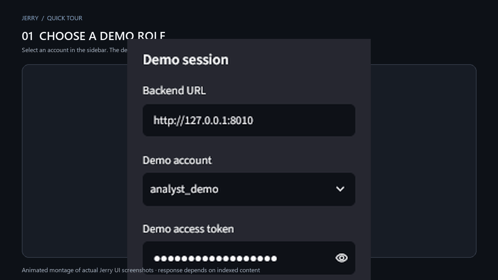
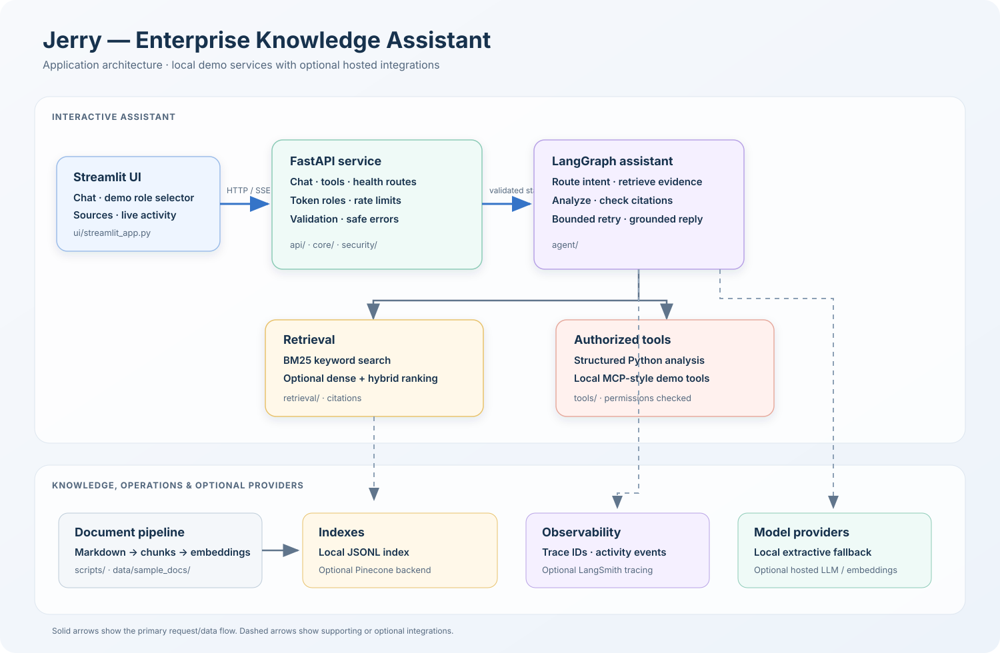
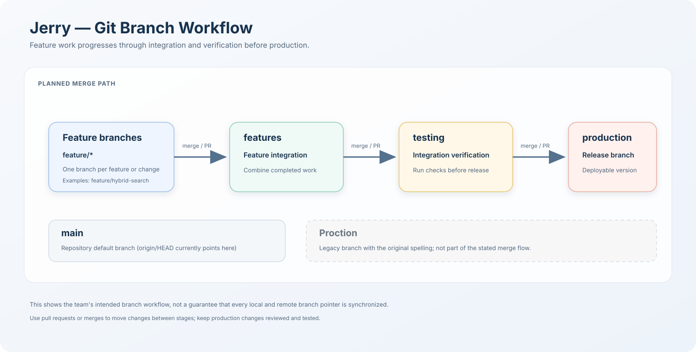
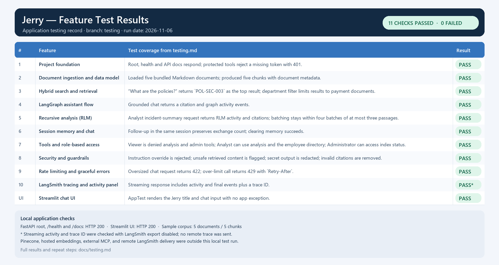
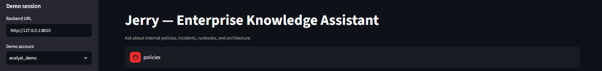
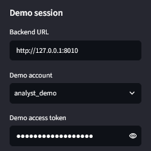
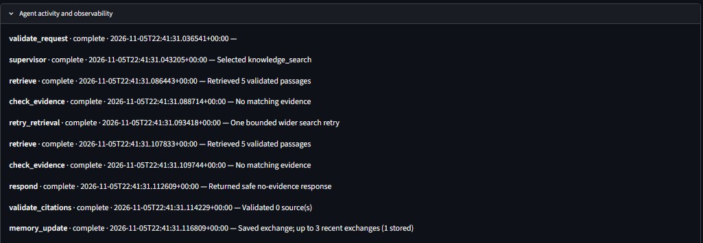
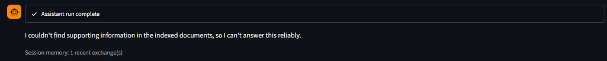
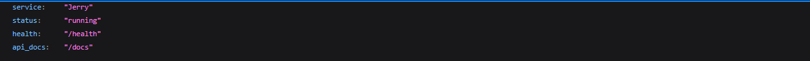

# Jerry



*Animated montage of actual UI screenshots. The sample response screens show an earlier local run; answer text depends on the indexed documents.*

Jerry is an enterprise knowledge assistant for asking questions about internal policies, incidents, runbooks, and architecture. It combines a Streamlit chat interface with a FastAPI service, a LangGraph workflow, searchable document sources, role-checked tools, and optional observability and hosted providers.

## Architecture

The diagram below shows the main request path and the supporting document, tool, and observability components. The repository root contains the Python packages; the project does not place them under an `app/` directory.



For the design notes, see [docs/architecture.md](docs/architecture.md).

## Git branch workflow

Feature branches flow into `features`, then into `testing` for verification, and finally into `production`. `main` is the repository's default branch. The older `Proction` branch is shown as a legacy branch and is not part of this workflow.



## Testing completion

The local testing record reports all 10 feature areas and the Streamlit UI check passing: 11 checks passed, 0 failed. This covers local services and sample data; external Pinecone, hosted embedding, MCP, and LangSmith trace delivery were not tested in that run. See the full [testing record](docs/testing/testing.md) for test details and repeat steps, including the verified role endpoint matrix.



## User manual: run and use Jerry

### 1. Install and prepare

Run these commands from the repository root in PowerShell. Python 3.11 or newer is required.

```powershell
python -m pip install -r requirements.txt
Copy-Item .env.example .env
```

The included sample documents can run with the local providers and demo accounts; hosted API keys are optional. Build or refresh the local document index before asking questions:

```powershell
python scripts/ingest_sample_data.py
```

The command reports how many documents and chunks were indexed. It writes the local index to `data/local_index.jsonl`.

### 2. Start Jerry

Open two PowerShell terminals at the repository root. Start the API in the first terminal:

```powershell
uvicorn api.main:app --reload --host 127.0.0.1 --port 8010
```

Start the chat interface in the second terminal:

```powershell
streamlit run ui/streamlit_app.py --server.port 8501
```

Open [http://127.0.0.1:8501](http://127.0.0.1:8501) in a browser. The API health check is at [http://127.0.0.1:8010/health](http://127.0.0.1:8010/health), and interactive API documentation is at [http://127.0.0.1:8010/docs](http://127.0.0.1:8010/docs).

### Run the development stack with Docker

Docker Compose starts the FastAPI backend and Streamlit UI in separate containers. The source tree is mounted into both containers so code changes reload during development. The API listens on container port `8010` and the UI on `8501`; override the host ports with `JERRY_API_PORT` and `JERRY_UI_PORT` if those ports are already occupied.

1. Create `.env` from `.env.example` if you do not already have a local environment file, then configure any optional providers or demo-token overrides.

   ```powershell
   if (-not (Test-Path .env)) { Copy-Item .env.example .env }
   ```

2. Build the image and start the development services:

   ```powershell
   docker compose up --build
   ```

3. Open [http://localhost:8501](http://localhost:8501). The API is available at [http://localhost:8010](http://localhost:8010), with health at `/health` and OpenAPI docs at `/docs`.

4. In a second terminal, build the local sample document index when needed:

   ```powershell
   docker compose run --rm ingest
   ```

   This writes `data/local_index.jsonl` in the project folder through the development bind mount. The ingestion service uses local embeddings and does not require a Pinecone API key.

Stop the stack with `Ctrl+C`, then run `docker compose down` to remove the containers. `.env` is excluded from the build context; keep provider keys in that local file and do not commit it.

### 3. Choose a demo account and ask a question

In the left sidebar, select a demo account. The supplied demo token is filled in automatically and masked. Ask about the indexed sample documents in the chat box and press Enter. For example:

- “What are the policies?”
- “What caused the settlement delay?”
- “What does the payments runbook say about latency?”

Jerry responds from the indexed material when it finds supporting evidence and lists source citations under **Sources**. If it cannot find evidence, it says so instead of inventing an answer. Expand **Agent activity and observability** to inspect the workflow steps. The screenshots below show the main parts of the interface and its local health check. They are focused crops of the genuine app screenshots supplied during development; the activity and no-evidence examples are from an earlier local run. For a supported sample question after indexing, Jerry should return citations instead of the no-evidence response shown in that historical example.

**Chat and question entry**



**Demo account selector and backend URL**



**Agent activity panel**



**No-evidence response example**



**API health check**



### 4. Demo roles

| Account | Capabilities |
| --- | --- |
| `viewer_demo` | Chat and knowledge search. Cannot call analysis, MCP-style, or administrative tools. |
| `analyst_demo` | Viewer capabilities plus structured analysis and the local employee/service tools. |
| `admin_demo` | All demo tools, including the administrative index-status endpoint. |

These are demo identities selected in the sidebar, not a production sign-in system. The API checks the demo token and resolves the role server-side. A forbidden tool call returns HTTP 403; select an account with the required capability to use that tool.

### 5. Continue or clear a conversation

Jerry keeps up to three recent exchanges in memory for the current user and session, which can help it understand short follow-up questions. Select **Clear conversation memory** in the sidebar to start a fresh conversation. Memory is in-process and resets when the API restarts.

### Troubleshooting

- **The page cannot connect:** keep both terminal processes running. Check `http://127.0.0.1:8010/health` and confirm the chat sidebar's Backend URL is `http://127.0.0.1:8010`.
- **No relevant documents are found:** run `python scripts/ingest_sample_data.py` from the repository root, then retry with one of the sample questions above. The default local index is used unless another vector backend is configured.
- **`ModuleNotFoundError` when starting Streamlit:** run `streamlit run ui/streamlit_app.py` from the repository root so the project packages are on the import path.
- **HTTP 429:** the demo account has reached its request limit; wait briefly and try again.
- **LangSmith is not shown as enabled:** tracing is optional. Configure `LANGSMITH_TRACING=true`, `LANGSMITH_API_KEY`, and `LANGSMITH_PROJECT` in `.env` if you want traces sent to LangSmith. Keep API keys private.

Use synthetic or sample information with the demo. Do not treat the demo tokens or role selector as production authentication.

## Requirements and setup

- Python 3.11 or newer
- Install dependencies: `python -m pip install -r requirements.txt`
- Copy `.env.example` to `.env` and set credentials only for optional hosted services.

## Run the API and UI

API (port 8010):

```powershell
uvicorn api.main:app --reload --host 127.0.0.1 --port 8010
```

Streamlit (second terminal):

```powershell
streamlit run ui/streamlit_app.py
```

## Ingest the sample documents

The default local mode requires no API keys and writes chunk records and reproducible local feature-hash vectors to `data/local_index.jsonl`:

```powershell
python scripts/ingest_sample_data.py
```

To send vectors to Pinecone, configure `PINECONE_API_KEY`, `PINECONE_INDEX`, and `PINECONE_NAMESPACE`, choose an embedding provider compatible with the index dimension, then run:

```powershell
python scripts/ingest_sample_data.py --backend pinecone
```

The default local hash embeddings are a dependency-free demonstration vectorizer, **not semantic embeddings**. For production-style vectors, set `EMBEDDING_PROVIDER=openai`, provide `OPENAI_API_KEY`, and install the optional OpenAI SDK listed in `requirements.txt`. Create a Pinecone index whose dimension matches the selected embedding model before ingestion. Pinecone integration is optional and is not considered configured until these steps succeed.

Chunk metadata preserves document ID, title, chunk index, department, document type, access level, and creation date for citation and future retrieval filters. Sample documents are fictional.

VECTOR_BACKEND=local

## Chat assistant (stage 4)

The FastAPI chat endpoint is `POST http://127.0.0.1:8010/api/chat`. A minimal request body is:

```json
{"query":"What caused the settlement delay?","session_id":"demo","role":"Viewer"}
```

The LangGraph workflow validates the request, classifies intent, retrieves evidence, checks support, performs at most one wider retrieval retry, generates a grounded answer, and validates citations against retrieved document IDs. The API returns the answer, citations, activity events, and a safe error summary. You can try it at `http://127.0.0.1:8010/docs`.

By default `LLM_PROVIDER=local` returns cited excerpts from the retrieved material without requiring an LLM key. Set `LLM_PROVIDER=openai` and `OPENAI_API_KEY` to use the configured chat model. If that provider fails, the graph records the failure and falls back to extractive cited output. The local answer is intentionally extractive; it is not presented as a model-generated synthesis.

## Recursive analysis (RLM-style)

Analysis-shaped questions such as “Summarize payment failure incidents from last year and identify recurring root causes” route into a separate LangGraph path. The path builds an explicit Python analysis plan, searches only incident reports with relevant metadata filters, splits the retrieved passages into batches of at most 3, processes no more than 4 batches, and aggregates cause signals with supporting source IDs. The activity list shows planning, search, each batch, and aggregation. “Last year” means the previous calendar year; “past year” means the trailing 365 days.

This is a bounded RLM demonstration: targeted retrieval and Python-controlled subtask/batch analysis avoid loading the whole corpus into an LLM prompt. Cause categories use transparent Python phrase patterns rather than an LLM judgment, and the answer states that limitation. Current sample reports are dated in 2025; if asked for the past 365 days in 2026, a no-results answer is expected. The previous calendar year 2025 query will match the included samples.

## Session memory and chat

Chat now runs through the Streamlit interface and `POST /api/chat`. Each UI session gets a unique session ID and carries the demo user ID and selected role to the backend. The API stores up to the 3 most recent exchanges per session in bounded process memory (up to 1,000 sessions). Recent user questions can clarify short follow-ups; previous assistant text is context only and retrieved documents remain the source of facts. OpenAI prompts receive a small conversation window with that same rule. Use **Clear conversation memory** to start a fresh session.

This demo memory is in-process and is cleared when the API restarts; it is not durable across deployments or shared across multiple workers. The API binds a session to the first user ID and role that uses it and rejects a change for that session. The current role/user fields are demo inputs, not authenticated identity; the RBAC stage will replace them with server-verified identity.

## Tools and role-based access

Use the demo account selector in the Streamlit sidebar. The backend derives the role from the `X-Demo-Token` header; the chat body no longer accepts a role. Local example tokens live in `.env.example` and can be overridden with environment variables. Do not deploy the example tokens as real credentials.

```bash
curl -X POST http://127.0.0.1:8010/api/chat \
  -H "X-Demo-Token: viewer-demo-token" \
  -H "Content-Type: application/json" \
  -d '{"query":"What caused settlement delays?","session_id":"demo-session"}'
```

Viewers can chat and search. Analysts can also run structured Python analysis and MCP-style employee/service tools. Administrators can use all tools, including `GET /api/tools/admin/index-status`. A Viewer request routed to multi-document analysis is safely denied with a visible authorization event; direct calls to protected analyst tools return HTTP 403. See [role permissions and endpoint results](docs/testing/role-based-testing.md).

## Security and guardrails

Requests and tool arguments are length/schema validated; retrieved chunks containing suspicious override, exfiltration, command, or permission-bypass patterns are dropped before LLM generation or analytics. Retrieved content and memory are labeled as untrusted in model instructions. Output length is bounded, key-like secret strings are redacted, and only citations matching retrieved document IDs are returned. Invalid citations are removed individually, with a cited extractive fallback when a factual answer has no valid citations. The detector uses simple phrase patterns and may miss novel attacks or flag benign text; see [guardrails and limits](docs/security-guardrails.md).

## Rate limits and graceful errors

Authenticated chat and tools are limited per demo user by a configurable token bucket. Defaults allow a burst of 20 requests with 10 tokens refilled per minute. Configure `RATE_LIMIT_CAPACITY` and `RATE_LIMIT_REFILL_PER_MINUTE`; HTTP 429 responses include `Retry-After`. Health endpoints stay available.

Configure downstream timeouts with `RETRIEVAL_TIMEOUT_SECONDS`, `LLM_TIMEOUT_SECONDS`, and `TOOL_TIMEOUT_SECONDS`. Retrieval and MCP-style failures produce safe messages, LLM failures fall back to cited extracts, and unexpected server errors expose a trace ID rather than a stack trace. See [resilience behavior and limits](docs/resilience.md).

## LangSmith tracing and live activity panel

To send traces, set `LANGSMITH_TRACING=true`, `LANGSMITH_API_KEY`, and `LANGSMITH_PROJECT` in `.env`. Tracing stays off if the flag or key is missing, and the app continues to run. Each graph run is tagged with its resolved role, demo user, session, and trace ID; retrieval, analysis, and MCP-style tool calls are traced as child runs. Keep demo data synthetic when sending traces to LangSmith.

The Streamlit chat now streams graph node updates live over `POST /api/chat/stream`, then shows the final answer, source list, and trace metadata. The ordinary `POST /api/chat` endpoint remains available. See [observability setup and event flow](docs/observability.md). The trace environment settings follow LangChain’s [official LangSmith setup](https://docs.langchain.com/oss/python/integrations/llms/openai).

With the default `EMBEDDING_PROVIDER=local`, retrieval uses BM25 keyword search with simple plural normalization (for example, **“policies”** matches the **“policy”** sample document). The local feature-hash vectors are not used as semantic ranking signals. Configure a semantic embedding provider and re-ingest the corpus to enable true dense-plus-sparse hybrid ranking.
