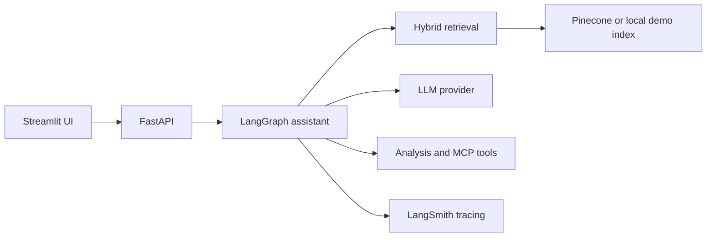

# Jerry architecture

The repository root is the Python package boundary. Feature modules live directly under the root rather than under an `app/` directory. `ui/` hosts Streamlit; `data/sample_docs/` contains demo knowledge; `scripts/` contains repeatable developer commands.
